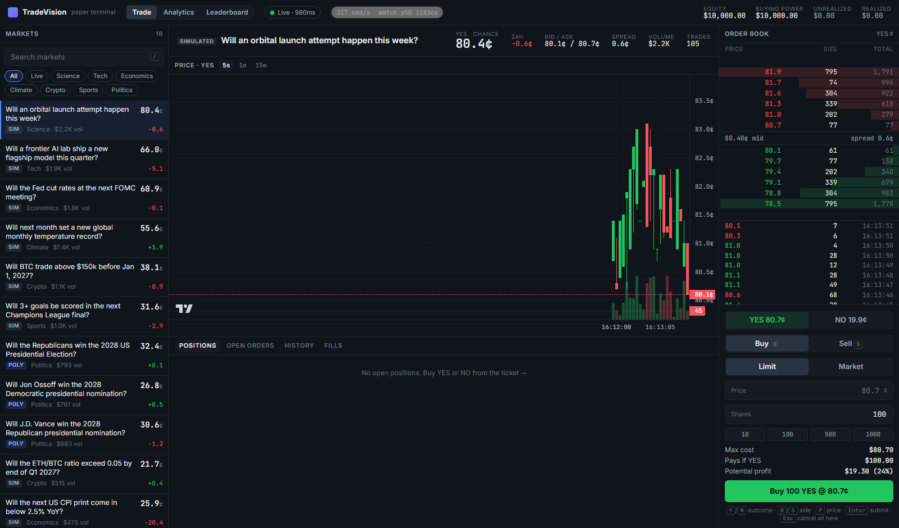
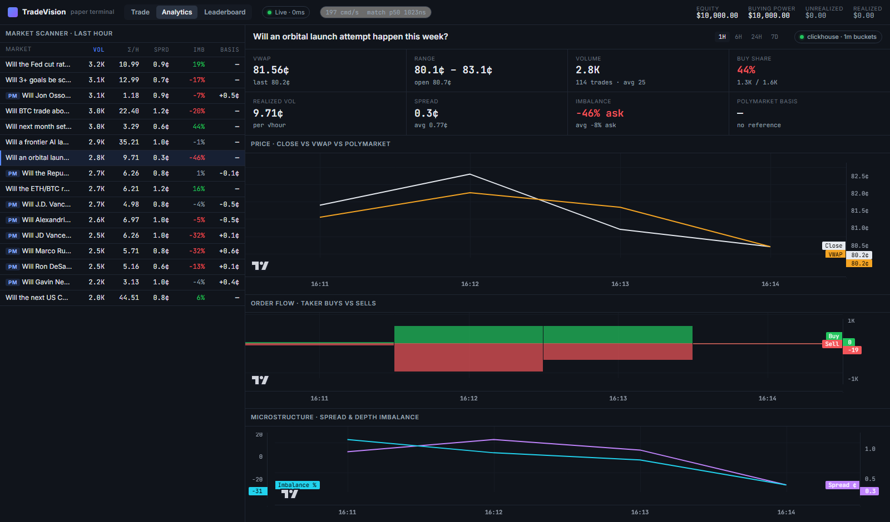

# TradeVision

**A real-time prediction-market exchange and trading terminal: from-scratch matching engine, live Polymarket data, exactly-once Postgres + ClickHouse projections, React terminal with analytics.**



YES/NO binary markets, Polymarket/Kalshi style, traded on a paper venue that implements the real mechanics, not an
animation of prices:
- price-time matching, with cross-outcome minting and burning
- pre-trade risk checks and position accounting
- durability, plus crash recovery from the journal

Half the markets are **live mirrors of Polymarket**. Their order books stream in over WebSocket, and the venue's
market-making bots anchor to them, so paper prices track the real ones.

| | |
|---|---|
| Engine throughput, end to end with journal | **~2.7 M commands/s** |
| Matching cost per command | **p50 203 ns · p99 < 1.5 µs** |
| Ingress → applied on the running server | **p50 4 µs · p99 0.3 ms** |
| Crash recovery (force-kill, restart) | **126,638 commands replayed in 172 ms**, nothing lost |
| Snapshots, inline → follower engine (paced 200k cmd/s) | **p99 528 ms → 54 µs**, rejected orders 115k → 0 |
| Postgres projection | **equals engine state exactly** (tested), exactly-once across replay + restart |
| Tests | 51 engine (incl. invariant fuzzer, recovery, follower) · 12 gateway (HTTP flows, real Postgres + ClickHouse via Testcontainers) · 10 frontend |
| Dependencies in the engine | **zero** |

## Run it

**Everything, one command** (Docker): engine + terminal + Postgres + ClickHouse.

```bash
docker compose up --build        # then open http://localhost:8080
```

**Without Docker** (projections off, everything else identical). Requires JDK 21+, Maven, Node 20+.

```bash
cd frontend && npm install && npm run build && cd ..   # builds the UI into the gateway's static resources
mvn clean install                                       # builds everything, runs all tests
java -jar gateway/target/tradevision-gateway-0.1.0-SNAPSHOT.jar
# open http://localhost:8080
```

On first start it creates 8 synthetic markets, discovers 8 live Polymarket markets, and starts the bots. State lives
in `./data` (journal, snapshots, market catalog), so stop it, restart it, or kill it: everything comes back.

- **Frontend dev with hot reload:** keep the jar running, then `cd frontend && npm run dev` → http://localhost:5173.
- **Without network access:** `--tradevision.polymarket.enabled=false` runs synthetic markets only.
- **Local jar + databases:** `docker compose up -d postgres clickhouse`, then run the jar with `--tradevision.postgres.enabled=true --tradevision.clickhouse.enabled=true --tradevision.clickhouse.user=tradevision --tradevision.clickhouse.password=tradevision`.
- **Tests:** `mvn verify` runs the Testcontainers suites automatically when Docker is available and skips them when it is not.

## What's interesting here

**Engine** ([matching-engine.md](docs/matching-engine.md), [benchmarks.md](docs/benchmarks.md))
- **The order book is an array, not a tree.** Prices are probabilities with only 999 ticks, so levels live in a dense array. The next-best price comes from a bitmap scanned with `LZCNT`/`TZCNT`, and cancels are O(1) via intrusive FIFO lists.
- **One book for both outcomes.** BUY NO @ 37¢ is an offer to sell YES @ 63¢. Opposite buyers mint a new contract pair and opposite sellers burn one.
- **Impossible to overdraw by construction.** A fuzzer asserts after every random command that money is conserved and every reservation matches an open order.
- **The journal is the database.** A binary command log uses CRC32C, group commit and torn-tail repair. The journaler is a parallel consumer of the same lock-free ring as the matcher (LMAX-style). Nothing is acknowledged before it's durable.

**Gateway** ([gateway.md](docs/gateway.md))
- **Durability-gated responses:** each HTTP answer is built from exactly the events its command caused, released only once journaled. Idempotent `clientOrderId`. `503` backpressure instead of unbounded queues.
- **WebSocket fan-out:** books are conflated to ≤ 20 Hz with absolute-value deltas, sequence numbers with client-side gap detection, and slow consumers are disconnected.
- **Polymarket ingestion without sequence numbers:** snapshot authority, stale/duplicate dropping, crossed-book detection triggers a resync, plus a watchdog and backoff.

**Projections & analytics** ([projections.md](docs/projections.md))
- **Exactly-once into Postgres without slowing the engine.** Each batch and its journal offset commit in one transaction. After any failure the writer re-reads the offset from the database, so an ambiguous COMMIT can't double-count. Gaps are recorded, never hidden.
- **Right store for each query.** Postgres: keyset-paginated history, a two-index `UNION ALL` for "fills where I'm maker *or* taker", a BRIN time index, and the leaderboard as one SQL query. ClickHouse: VWAP, volatility, flow, spread and imbalance aggregated server-side.
- **Degrades instead of failing.** Every analytics/history response names its `source`. With the databases off, the same API is served from memory.



**Terminal**
- Zustand stores are split by update frequency. The market list is virtualized, and the chart updates candles incrementally from the trade stream.
- Connection, stale and RTT states. Optimistic but honest order UX. Keyboard-first trading.
- Trade / Analytics / Leaderboard views (deep-linkable, `Alt+T/A/L`). Sortable market scanner, charts of close vs VWAP vs Polymarket, taker flow, spread and imbalance. Full history with "load older" over keyset pagination. Unacknowledged orders can be cancelled by client id.

**Performance investigations, each measured before and after:**
1. Disk I/O on the matching thread: **wrong hypothesis**, kept the change anyway.
2. The Windows timer oversleeping `parkNanos` under load: p99 cut 26×.
3. Hash-table rehash pauses: max stall cut 7×.
4. The same timer issue in reverse at *low* load: p50 cut from 15.5 ms to 4 µs with wake-on-submit, which later turned out to make busy-spin unnecessary at high load too.
5. Snapshot pauses: moved to a follower engine, p99 during snapshots 528 ms → 54 µs.
6. Linux re-measure: the remaining p99.9 tail shows up there too, so it's not the Windows timer. Bare-metal `isolcpus` is next.

## Layout

```
engine/     zero-dependency core: book, matching, risk, accounts, journal, snapshots, ring buffer, runner
bench/      JMH benchmarks + end-to-end load harness
gateway/    Spring Boot: REST/WS API, read models, durability gate, bots, Polymarket feed,
            Postgres/ClickHouse projections (Flyway migrations), analytics
frontend/   React + TypeScript terminal (Vite, Zustand, Lightweight Charts, TanStack Virtual)
docs/       ARCHITECTURE, matching-engine, gateway, projections, benchmarks, ROADMAP, adr/
```

TradeVision is paper trading only and is not an HFT venue. Real-money exchange latency involves far more than a fast in-process matcher.
